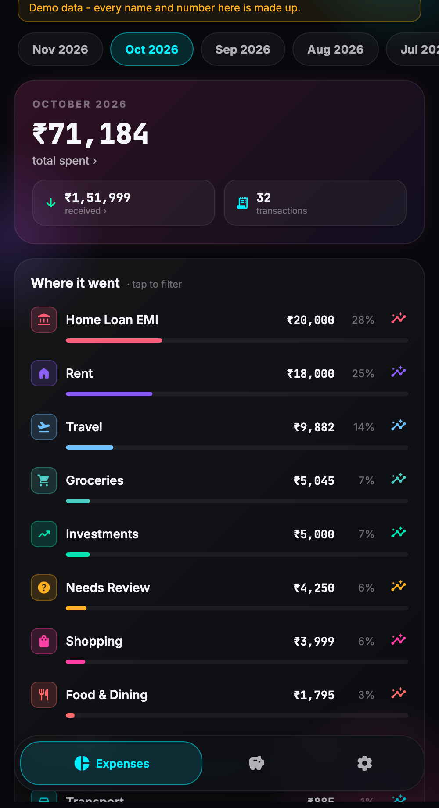
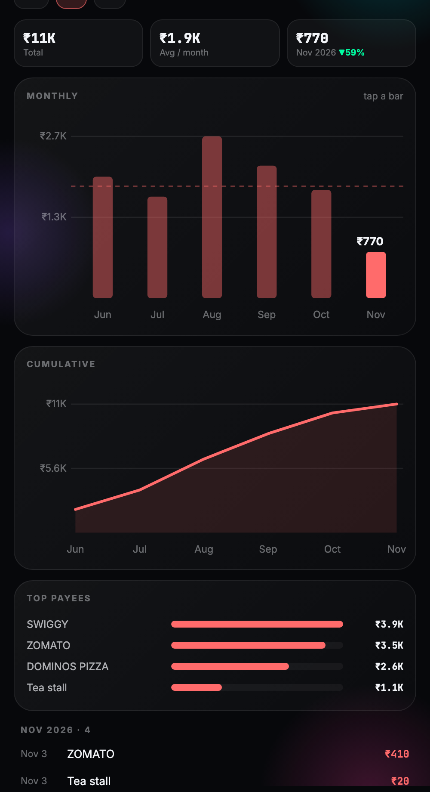
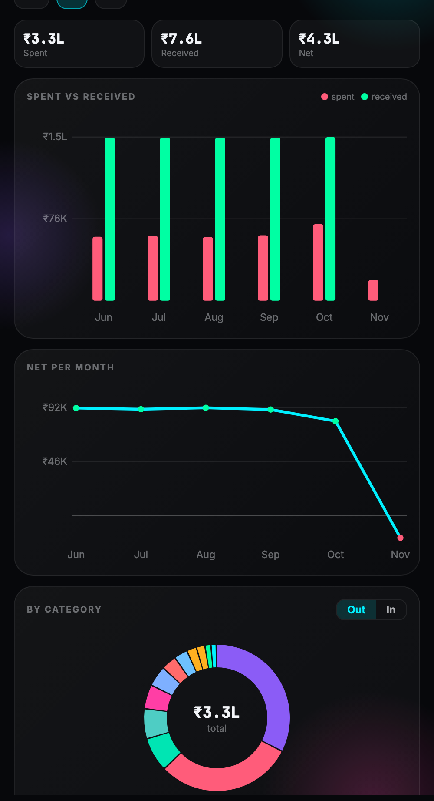
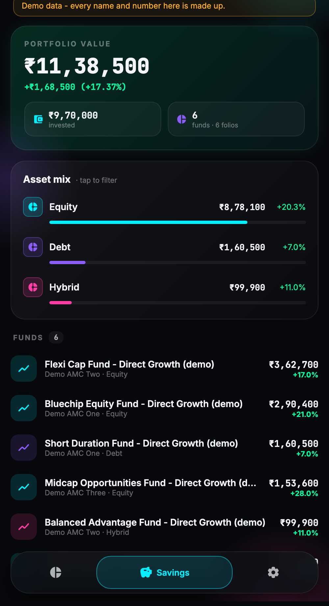
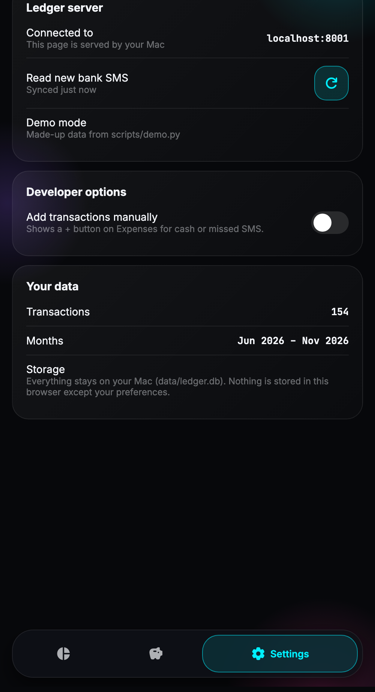

# Expense Ledger from Bank SMS (India)

Turn the bank SMS on your iPhone into a clean expense ledger on your Mac. Everything runs locally.

- **Reads** bank SMS from macOS Messages (`chat.db`): debits, credits, card spends, UPI, NEFT, EMIs and refunds.
- **Counts each rupee once:**
  - Credit-card bill payments are transfers, not spending.
  - Duplicate alerts are merged.
  - Moves between your own accounts are left out.
  - Loan EMIs and prepayments are recognised.
- **Ignores non-transactions:** OTPs, payment requests, due-date reminders and statements.
- **Categorises spending** with rules and your own payee tags. Tag a payee once and every past and future
  transaction from it follows.
- **Checks itself:** 8 automatic checks, plus credit-card statement reconciliation.
- **Web app** served from your Mac. Open it in any phone or desktop browser on your Wi-Fi; there's nothing to install.
  It has a monthly summary, a review list, per-category analytics, manual entries and savings.
- **Optional AI suggestions** for unknown payees, through your own Claude Code login.

Architecture: open [`docs/architecture.html`](docs/architecture.html) in a browser.

<p>
  
  
  
</p>
<p>
  
  
  
</p>

*Screenshots use demo data: every name and number is made up.*

## Try the demo (2 minutes, no setup)

```bash
git clone <this repo> expense-ledger && cd expense-ledger
python3 scripts/demo.py          # then open http://localhost:8001
```

`scripts/demo.py` writes made-up data into the same files the real system uses:

- **`demo/chat.db`:** made-up bank SMS in the macOS Messages database format.
- **`demo/data/`:** `ledger.db`, `rules.json`, `transactions.csv` and the reports.
- **`demo/holdings.json`:** a made-up mutual-fund portfolio.

It then runs the real pipeline and web app on that data, so you can try everything without touching your Messages.
Your own data folder is never read or written.

## Privacy

- Your data stays on your Mac. The repository ignores `data/` and `config/accounts.json`, where all personal data lives.
- Nothing is sent anywhere unless you use AI suggestions. Then only the payee name or UPI ID, the payment channel,
  the count and total, and one sample SMS with all 5+ digit numbers masked are sent to Claude through the `claude` CLI.
- The phone app talks only to your Mac on your local network.

## Requirements

| What | Why |
|---|---|
| A Mac with **Messages** receiving your SMS | On the iPhone: Settings → Apps → Messages → **Text Message Forwarding** → enable your Mac (or use Messages in iCloud) |
| **Python 3.9+** | The ledger uses only the standard library, so there are no packages to install |
| **Full Disk Access** for your terminal | macOS protects `~/Library/Messages/chat.db`: System Settings → Privacy & Security → Full Disk Access |
| *Optional:* [Claude Code](https://claude.com/claude-code) | AI category suggestions (`claude` CLI, signed in) |
| *Optional:* Flutter + Xcode + an iPhone | The Aptiq phone app |

**Supported SMS formats** (others land in a review list): HDFC Bank (savings, debit and credit cards, UPI, NEFT,
NACH/ACH), ICICI credit cards, SBI Card, SBI savings and loan accounts, Scapia (Federal Bank) cards.
To add a bank, see [Adding a bank format](#adding-a-bank-format).

## Install

```bash
git clone <this repo> expense-ledger && cd expense-ledger
python3 -m venv .venv
cp config/accounts.example.json config/accounts.json
```

Edit `config/accounts.json` with your own details. Each field is explained inside the file. The most important ones:

- **`owner_names`:** your name as banks print it. Transfers to yourself are then not counted as spending.
- **`accounts`:** one entry per savings account, card and loan.
  - `families` is the SMS sender code: `VM-HDFCBK-S` → `HDFCBK`.
  - `numbers` are the last digits the bank prints.
- **`card_bill_payees`, `loan_emi_payees`, `salary_payers`:** who you pay card bills and EMIs to, and who pays your salary.
- **`upi_spend_max`:** unknown UPI payments below this amount are filed as "UPI Spend" instead of asking you.

## Use

```bash
.venv/bin/python -m app.ledger                 # read new SMS, rebuild, run checks, write reports
.venv/bin/python -m app.ledger --publish       # also write data/transactions.csv for the phone app
.venv/bin/python -m app.ledger review          # payees to tag, biggest money first (--month 2026-10)
.venv/bin/python -m app.ledger tag "<payee key>" "Food & Dining" --name "Tea stall"
.venv/bin/python -m app.ledger categories      # list valid categories
```

The first run copies your SMS into `data/ledger.db`. Later runs only read new messages. The output includes:

- a summary by kind and category
- **acceptance checks** (all should say PASS)
- **card reconciliation:** each card's statement totals against the transactions seen. Large gaps usually mean
  missing SMS.

Reports in `data/ledger/`:

| File | Contents |
|---|---|
| `ledger.csv` | Every money movement, including transfers |
| `events.csv` | Every money SMS and how it was linked |
| `review.csv` | Messages that need a human |
| `reconciliation.csv` | Card statements against transactions |

**How a transaction gets its category** (first match wins):

1. Your edit to that one transaction.
2. Your **payee tag**.
3. Rules from linking: Home Loan EMI or Prepayment, Salary, Refund, Cash Withdrawal.
4. Merchant keywords. Add your own under `extra_keywords` in the config.
5. An unknown UPI payment under `upi_spend_max` → **UPI Spend**.
6. Everything else → **Needs Review**. People are never guessed; tag them as **FnF Transfer**.

Your tags and edits are stored in `data/rules.json` and re-applied on every rebuild.

## Web app

```bash
.venv/bin/python serve_for_aptiq.py      # serves the web app and the API on port 8000
```

- **On the Mac:** open `http://localhost:8000`.
- **On your phone,** on the same Wi-Fi: open `http://<your-mac>.local:8000`, where `<your-mac>` is the output of
  `scutil --get LocalHostName`. Use **Add to Home Screen** to get an app-like icon.
- **Keep it running at login:** `scripts/install_sync_server.sh` (`--remove` to undo).

What it does:

- **Expenses:** pick a month; tap *total spent* or *received* to filter; tap a category to see its transactions; tap
  the chart icon for that category's history. Tap any transaction to recategorise it, with *Apply to all from this
  payee*, view the raw SMS, edit or hide it. The refresh button reads new SMS.
- **Review:** unknown payees, biggest money first. Optional AI suggestions; *Accept for all* tags the payee.
- **Analytics:** spent vs received, net per month, and a category donut. Each category has monthly bars, a
  cumulative trend and top payees.
- **Savings:** a mutual-fund portfolio, if you provide one (see below).
- **Settings → Developer options:** turn on the **+** button to add cash or missed transactions by hand.

The page is plain HTML, CSS and JavaScript in `web/` (no build step). It keeps only your preferences in the
browser; all data stays on the Mac.

> **Security:** the server has no login. Anyone on the same Wi-Fi who knows the address can see your ledger.
> Run it only on a network you trust, such as home Wi-Fi, never on public Wi-Fi.

## Native iPhone app (optional)

The web app covers everything. If you also use the Flutter **Aptiq** app:

1. **Start the sync server:** `.venv/bin/python serve_for_aptiq.py` (port 8000), or keep it running at login with
   `scripts/install_sync_server.sh` (remove it with `--remove`). If its log shows a Full Disk Access error, grant Full
   Disk Access to the Python binary the error names.
2. **Install the Aptiq Flutter app** on your iPhone: `APTIQ_DIR=<path to Aptiq> scripts/install_aptiq_iphone.sh <device-id>`.
   Get `<device-id>` from `flutter devices`. A free Apple ID signs the app for 7 days, so re-run this weekly.
3. **Connect the app:** in Aptiq → Settings, set the sync URL to `http://<your-mac>.local:8000/transactions.csv`.
   `<your-mac>` is the output of `scutil --get LocalHostName`.

Server endpoints used by the app:

| Endpoint | Does |
|---|---|
| `GET /transactions.csv` | The ledger |
| `GET /review?month=` | Payees to review |
| `POST /review/suggest` | AI suggestions |
| `POST /rules` | Tag a payee |
| `POST /refresh` | Read new SMS and rebuild |
| `POST /transactions` | Add a manual entry |
| `PATCH`/`DELETE /transactions/<id>` | Edit or hide a transaction |
| `GET /holdings.json` | Savings tab |

- **Manual entries:** enable Settings → Developer options in the app. They are stored in `data/ledger.db`.
- **Savings tab:** serves a mutual-fund `holdings.json` built by a separate project. Set `APTIQ_HOLDINGS_PATH` to
  its location.

## AI suggestions (optional)

- **What you see:** on the Review screen, each unknown payee gets a suggested category. **Accept for all** saves it as
  a payee tag.
- **How it runs:** the server runs `claude -p` (Claude Code, non-interactive) with **all tools disabled**, no saved
  session, and a JSON schema that only allows your categories. It uses your Claude Code login, so no API key is needed.
- **Cache:** suggestions are stored per payee, so each payee is sent once.
- **Failures:** if Claude Code is missing, signed out, over its limit or slow, the app shows a short note. Everything
  else keeps working.

## Adding a bank format

Templates live in `app/ledger/templates.py`. Each one is a regular expression with named groups (`amt`, `acct`,
`payee`, `ref`, …) plus the message type and direction. To add a bank:

1. Run `.venv/bin/python -m app.ledger` and look at `data/ledger/review.csv`, which lists messages no template matched.
2. Add a `T(...)` entry for each new message shape, and the bank's sender code to `BANK_FAMILIES`.
3. Add a test with an example SMS (use made-up numbers) to `tests/test_ledger.py`.
4. Re-run. The `Template coverage` check should say PASS.

## Tests

```bash
.venv/bin/python -m unittest discover -s tests -t .
```

## Project layout

| Path | What it is |
|---|---|
| `app/ledger/ingest.py` | Copies new SMS from `chat.db` (read-only) |
| `app/ledger/templates.py` | Bank SMS formats → typed messages |
| `app/ledger/link.py` | Card bills, own transfers, loans, duplicates |
| `app/ledger/categories.py`, `keywords.py` | Categories, payee tags, keyword rules |
| `app/ledger/checks.py` | Acceptance checks and card reconciliation |
| `app/ledger/ai_suggest.py` | Optional AI suggestions through the Claude Code CLI |
| `app/ledger/manual.py` | Manually added transactions |
| `app/ledger/service.py`, `__main__.py` | Rebuild/publish and the command line |
| `serve_for_aptiq.py` | Server for the web app and API (also used by the native app) |
| `web/` | The web app (HTML, CSS, JavaScript) |
| `scripts/demo.py` | Demo mode with made-up data |
| `config/accounts.example.json` | Template for your private `config/accounts.json` |
| `scripts/` | Demo, sync-server login item, iPhone install helper |

## Disclaimer

This is a personal tool, not financial advice. SMS formats change. Always compare important numbers with your
bank statements. The reconciliation report is there to help with that.
